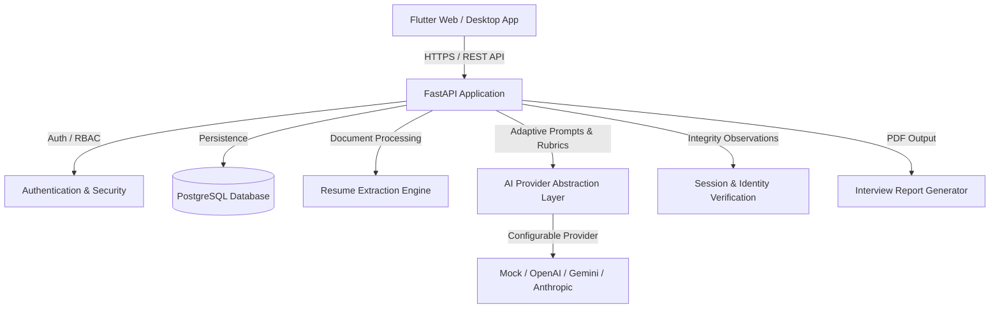

# Architecture Documentation

## System Overview
The **AI-Powered Intelligent Interview System** is an end-to-end recruiter-and-candidate recruitment platform designed to conduct structured, objective, and adaptive interviews.

## Frontend Architecture
- **Framework**: Flutter (Web & Desktop target)
- **State Management**: Riverpod
- **Routing**: GoRouter with route guards based on authenticated user role (`Candidate`, `Recruiter`, `Admin`)
- **Networking**: Dio with interceptors for token refresh, error handling, and request logging
- **Design System**: Professional responsive layout supporting desktop, tablet, and mobile breakpoints

## Backend Architecture
- **Framework**: FastAPI (Python 3.11+)
- **Architecture Style**: Layered Clean Architecture (Routers -> Services -> Repositories -> Models/DB)
- **Validation**: Pydantic v2 schemas for all inputs and outputs
- **ORM & Migrations**: SQLAlchemy 2.x declarative models with Alembic migrations
- **Authentication**: JWT tokens with Argon2id password hashing and role-based permissions

## Database & Persistence Architecture
- **Engine & Pool**: SQLAlchemy 2.x engine with configurable connection pooling (`pool_size`, `max_overflow`, `pool_recycle`, `pool_pre_ping`).
- **Driver Support**: Automatic normalization supporting both `psycopg3` (`psycopg[binary]`) and `psycopg2`.
- **Declarative Base**: `app.models.base.Base` with standardized UUID (`UUIDMixin`) and UTC timestamp (`TimestampMixin`) components.
- **Migrations**: Alembic with environment-driven dynamic URL resolution (`settings.DATABASE_URL`), model metadata auto-discovery, and forward/backward revision tracking.
- **Readiness vs Liveness**:
  - `/health` and `/api/v1/health`: Instant liveness checks without database dependency.
  - `/api/v1/health/database`: Dedicated readiness probe executing lightweight ping queries and reporting sanitized connectivity state (HTTP 200 vs 503).

## AI and Resume Subsystems
- **AI Engine**: Modular adapter pattern with fallbacks and structured JSON output validation.
- **Resume Ingestion & Parsing Pipeline**:
  - Multi-tier validation: Magic byte signatures (`%PDF-`, `PK\x03\x04`), extension confirmation, 10MB size ceiling, filename sanitization with UUID-prefixed keys stored outside web root (`backend/uploads/resumes`).
  - Text extraction: `pypdf` for PDF parsing and `python-docx` for Word documents; scanned documents lacking text layers trigger clear `needs_ocr` status rather than falsified output.
  - Sanitization: Prompt injection containment neutralizing untrusted adversarial instructions inside resumes.
  - Heuristic analysis: 200+ technology and tool taxonomy, education extraction, experience duration estimation, and structured JSON output.
- **Transparent Job Matching Engine**:
  - Deterministic skill gap analysis: Required skills (70% weight) and preferred skills (30% weight).
  - Component breakdown: Skill score, experience score, education score, and weighted overall score.
  - Honest explanations & limitations disclaimer: Explicitly distinguishes unmentioned skills from confirmed gaps; never infers protected personal characteristics or claims an objective probability of job success.
- **Adaptive Interview Session Engine (Phase 6)**:
  - Deterministic question generation: Configurable question bank and taxonomy mapped across skills (Python, FastAPI, Flutter, Dart, PostgreSQL, Docker, Git) and categories (`technical`, `problem_solving`, `project_experience`, `behavioral`).
  - Transparent difficulty calibration: Adjusts subsequent question difficulty dynamically using answer substance metadata (character and word length) without pre-evaluating correctness (reserved for Phase 7).
  - Stateful session lifecycle: Explicit state machine (`draft` -> `in_progress` -> `completed` / `abandoned`) guarding against invalid transitions, skipping questions, or cross-session tampering.
  - Candidate privacy isolation: Candidate responses are inaccessible to recruiters by default, preserving psychological safety and answer integrity.
- **Integrity & Observations**: Distinct consent-based identity verification keeping audit telemetry separate from competency scoring.

