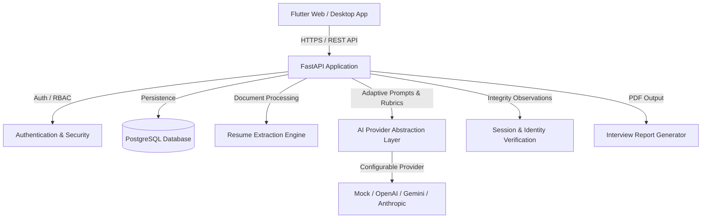

# Architecture Documentation

## System Overview
The **AI-Powered Intelligent Interview System** is an end-to-end recruiter-and-candidate recruitment platform designed to conduct structured, objective, and adaptive interviews.

## Frontend Architecture
- **Framework**: Flutter (Web & Desktop target)
- **State Management**: Riverpod
- **Routing**: GoRouter with route guards based on authenticated user role (`Candidate`, `Recruiter`, `Admin`)
- **Networking**: Dio with interceptors for token refresh, error handling, and request logging
- **Design System**: Professional responsive layout supporting desktop, tablet, and mobile breakpoints

## Backend Architecture
- **Framework**: FastAPI (Python 3.11+)
- **Architecture Style**: Layered Clean Architecture (Routers -> Services -> Repositories -> Models/DB)
- **Validation**: Pydantic v2 schemas for all inputs and outputs
- **ORM & Migrations**: SQLAlchemy 2.x declarative models with Alembic migrations
- **Authentication**: JWT tokens with Argon2id password hashing and role-based permissions

## Database & Persistence Architecture
- **Engine & Pool**: SQLAlchemy 2.x engine with configurable connection pooling (`pool_size`, `max_overflow`, `pool_recycle`, `pool_pre_ping`).
- **Driver Support**: Automatic normalization supporting both `psycopg3` (`psycopg[binary]`) and `psycopg2`.
- **Declarative Base**: `app.models.base.Base` with standardized UUID (`UUIDMixin`) and UTC timestamp (`TimestampMixin`) components.
- **Migrations**: Alembic with environment-driven dynamic URL resolution (`settings.DATABASE_URL`), model metadata auto-discovery, and forward/backward revision tracking.
- **Readiness vs Liveness**:
  - `/health` and `/api/v1/health`: Instant liveness checks without database dependency.
  - `/api/v1/health/database`: Dedicated readiness probe executing lightweight ping queries and reporting sanitized connectivity state (HTTP 200 vs 503).

## AI and Speech Subsystems
- **AI Engine**: Modular adapter pattern with fallbacks and structured JSON output validation
- **Resume Parsing**: Safe text extraction from PDF/DOCX with transparent skill matching against job descriptions
- **Integrity & Observations**: Distinct consent-based identity verification keeping audit telemetry separate from competency scoring
